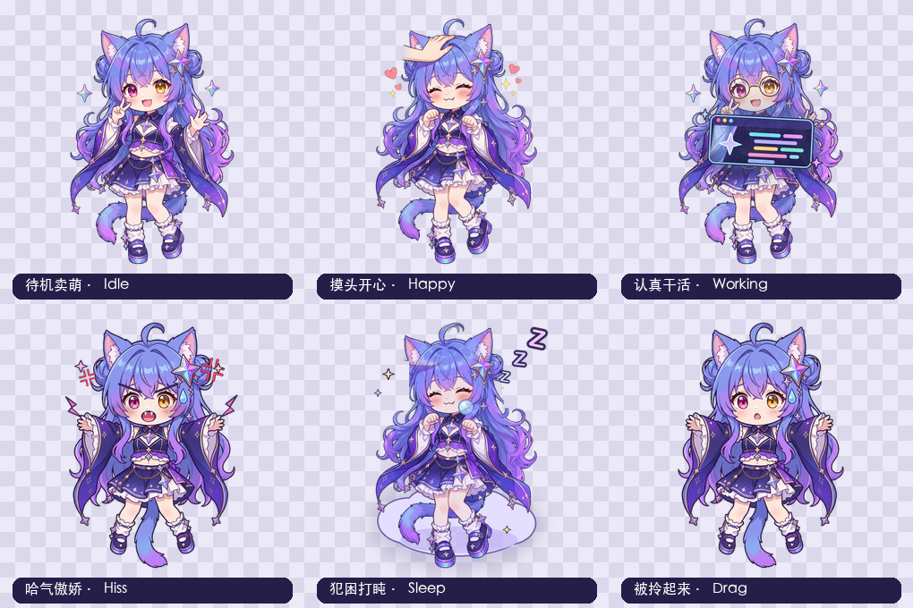

# ✦ GeminiPet · 哈基米 macOS 透明悬浮桌宠

一款专为 **macOS** 打造的原生轻量级透明悬浮桌面宠物，以中文社区经典 **Gemini 娘（哈基米猫娘）** 为灵感制作，对标 **ChatGPT Desktop Pet** 的交互体验：小巧克制、悬停呼出快捷控制条、支持快捷对话、语音对话、看屏幕提问、活动托盘、Mini 纯快捷栏模式与 **Antigravity** 后台任务状态联动。



## ✨ 核心功能

- **小巧克制的透明悬浮陪伴**：默认 **112px** Q 版二头身（与 ChatGPT 桌宠默认尺寸一致），无边框全桌面置顶、跨 Space 跟随、不占 Dock 栏，支持「克制微动 / 完全静态 / 活泼动画」三档动效。
- **悬停快捷控制栏（Hover Controls）**：鼠标移到桌宠上自动浮现，移开自动隐藏：
  - **💬 快捷对话（全局快捷键 `Option + G` / 双击桌宠）**：直接在桌面浮窗多轮提问，支持极速模式（`gemini-3.5-flash-lite`）与深度思考模式（`gemini-4-hydrogen`），一键复制与朗读。
  - **🎙 语音对话模式（Voice Mode）**：一键录音发给 Gemini 多模态理解，并通过 **Gemini TTS** 自然语音播报回复。
  - **📸 看屏幕提问（Screen Context）**：静音截取当前屏幕并附带到对话或语音提问中，快速让 AI 帮你看报错或总结当前页面。
  - **🔔 活动与任务托盘（Activity Tray）**：追踪 Antigravity 后台运行进度与历史回复，一键跳回 Antigravity 或 Gemini App。
- **Mini 纯快捷栏模式**：隐藏角色立绘，仅保留一条极简悬浮快捷药丸条。
- **极简右键 + 原生设置窗口**：右键桌宠仅保留「设置…」与「隐藏桌宠」两项，所有个性化配置统一收进独立原生设置窗口。
- **6 套透明底 512×512 Q 版表情包**：内置于 [`stickers/`](./stickers) 目录，可直接用于聊天软件表情包。

## 🚀 快速构建与运行

### 环境要求
- macOS 13.0+（Apple Silicon / Intel，需安装 Xcode Command Line Tools 自带的 `swiftc`）
- 如需使用快捷对话、语音对话与看屏幕提问功能，请先安装并登录 [`gemini-api`](https://github.com/google-gemini/gemini-api-cli) CLI（确保 `~/.local/bin/gemini-api` 已通过 `gemini-api configure` 或 `GEMINI_API_KEY` 完成认证）。

### 一键编译并启动

```bash
git clone https://github.com/leoangelos065/GeminiPet.git
cd GeminiPet
chmod +x scripts/build_app.sh
./scripts/build_app.sh
open GeminiPet.app
```

> 首次使用 **语音模式** 或 **看屏幕提问** 时，macOS 会按系统规范申请麦克风 / 屏幕录制权限，授权后即可使用。

## 🔗 Antigravity 后台状态联动（可选）

将 [`scripts/agy_pet_hook.py`](./scripts/agy_pet_hook.py) 配置到工作区 `.agents/hooks.json`（或全局 `~/.gemini/config/hooks.json`）中，即可让桌面上的哈基米实时同步 Antigravity 的思考、执行与任务完成状态：

```json
{
  "gemini-pet-status": {
    "PreInvocation": [
      {
        "type": "command",
        "command": "python3 \"/你的路径/GeminiPet/scripts/agy_pet_hook.py\"",
        "timeout": 5
      }
    ],
    "PostToolUse": [
      {
        "matcher": "*",
        "hooks": [
          {
            "type": "command",
            "command": "python3 \"/你的路径/GeminiPet/scripts/agy_pet_hook.py\"",
            "timeout": 5
          }
        ]
      }
    ],
    "Stop": [
      {
        "type": "command",
        "command": "python3 \"/你的路径/GeminiPet/scripts/agy_pet_hook.py\"",
        "timeout": 5
      }
    ]
  }
}
```

## 📁 目录结构

```text
GeminiPet/
├── src/
│   └── GeminiPetApp.swift      # macOS 原生 SwiftUI + AppKit 桌宠主程序
├── scripts/
│   ├── build_app.sh            # 一键编译打包 GeminiPet.app
│   ├── pet_ai_bridge.py        # 调用 gemini-api 的快捷对话 / 语音 / 识图桥接脚本
│   ├── agy_pet_hook.py         # Antigravity 生命周期 Hook 状态同步脚本
│   ├── cutout.py               # 绿幕抠图与 512×512 透明素材规范化脚本
│   └── make_variants.py        # 扩展状态素材生成与预览图合成脚本
├── sprites/                    # 应用内置的 6 套透明底 Q 版状态图
├── stickers/                   # 导出的 6 张独立透明 PNG 表情包
└── sprites_preview.png         # 全套素材总览图
```

## 🎨 致谢

- 角色外观设定灵感参考中文社区 **ZipZipPipe** 创作的 Gemini 娘（蓝紫渐变长发、猫耳猫尾、异色瞳、四芒星发饰）。
- 交互理念参考 **ChatGPT Desktop Pet** 的悬停控制栏、Mini 模式与活动托盘设计。
